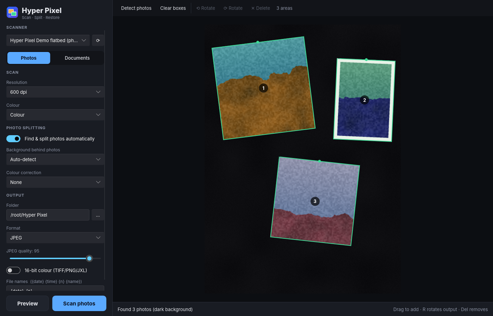

# Hyper Pixel

A fast, dark-themed scanner app for Linux. Hyper Pixel's main feature is **rapid photo scanning**:
lay several prints on the flatbed, press one button, and get each photo cropped, straightened
and saved as its own file.



- **Automatic multi-photo splitting** in pure Rust. Edges are located to a fraction of a
  pixel and straightened with bicubic resampling.
- **Live crop preview.** The preview scan shows exactly what will be cut out. You can drag
  boxes to move them, drag corners to resize, use the handle to rotate, or draw a new box.
  Untouched boxes are re-fitted on the full-resolution scan for maximum precision.
- **Only the needed area is scanned** at high resolution, which saves time.
- **Colour correction and restoration:** Auto, Restore faded (per-channel recovery of
  colour-shifted prints), Vivid and Monochrome.
- **Dust and scratch removal** (Light / Normal / Strong). Specks, hairs and scratches are
  found by their size, shape, colourlessness and crisp edges, then filled from the
  surrounding texture. Only defect pixels change.
- **AI restoration on the CPU** (optional, ~410 MB download): colourise black-and-white
  photos with DDColor, and fill large damage with LaMa. Both run in pure Rust (`rten`), so
  no GPU is needed.
- **Documents:** deskew, paper whitening, black & white, multi-page scanning through the
  document feeder, and **OCR** into searchable PDFs (pure-Rust `ocrs` engine, models
  bundled).
- **Formats:** JPEG, PNG, TIFF, JPEG XL (lossless), WebP (lossless), BMP and PDF. PNG, TIFF
  and JXL support 16-bit, and DPI metadata is written where the format supports it.
- **Works with any SANE scanner.** The system's SANE library and drivers are loaded at
  runtime.

## Install

Download the AppImage from the [continuous release](https://github.com/singularity098/Hyper-Pixel/releases/tag/continuous),
then:

```bash
chmod +x Hyper_Pixel-*-x86_64.AppImage
./Hyper_Pixel-*-x86_64.AppImage
```

You need your distribution's SANE package (`sane`, `sane-backends` or `libsane1`). Check
that your scanner shows up with `scanimage -L`.

## Tips for photo scanning

- **Put a black sheet of paper or card behind the photos**, under the lid. It gives the most
  reliable edge detection, especially for photos with white borders.
- Leave a few millimetres between prints. Hyper Pixel can split photos that touch, but gaps
  are more reliable.
- 600 dpi (the default) captures everything a typical print holds. Use 1200 dpi with 16-bit
  TIFF for archival masters or small prints you want to enlarge.
- Keyboard shortcuts: `Del` removes the selected box, `r` and `R` rotate its output.

## Command line

The AppImage also contains `hyper-pixel-cli`:

```bash
./Hyper_Pixel.AppImage cli split scans/*.png -o photos --color restore   # split existing scans
./Hyper_Pixel.AppImage cli restore old/*.jpg -o clean --dust normal --colorize  # restore photos
./Hyper_Pixel.AppImage cli fetch-models ai                                # AI models (~410 MB)
./Hyper_Pixel.AppImage cli ocr page1.png page2.png --pdf doc.pdf          # OCR to searchable PDF
./Hyper_Pixel.AppImage cli devices                                        # list scanners
```

## Building

```bash
cargo build --release          # binaries: hyper-pixel, hyper-pixel-cli
HYPER_PIXEL_MOCK=1 cargo run --release -p hp-app   # run with demo scanners, no hardware needed
./packaging/build-appimage.sh  # dist/Hyper_Pixel-*.AppImage
```

## License

GPL-3.0-or-later. The optional AI models are downloaded separately and are Apache-2.0:
[LaMa](https://github.com/advimman/lama) (ONNX export by
[Carve](https://huggingface.co/Carve/LaMa-ONNX)) and
[DDColor](https://github.com/piddnad/DDColor) (ONNX export by
[Qualcomm AI Hub](https://huggingface.co/qualcomm/DDColor)).
